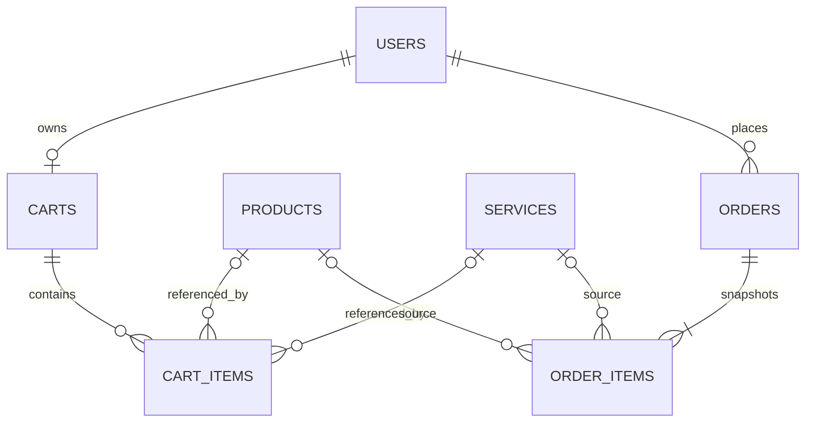

# GZSLP-MS System Design

**Document type:** Living, repository-local system design description  
**Source:** ENGGSF2 Software Design Document, Prelim Design Check, dated 2026-08-22  
**Last reviewed:** 2026-10-11  
**Implementation status:** Early MVP; this document distinguishes implemented behavior from proposed work.

This document mirrors the supplied SDD's organization while describing the application as it exists in this repository. It is not a replacement for the course SDD or the approved SRS. Keep the course document and this implementation record aligned as requirements and code change.

## Status Legend

- **Implemented:** Present in the application and covered by automated tests.
- **Partial:** Some foundational behavior exists, but the SDD capability is incomplete.
- **Planned:** Required or described by the SDD but not implemented in the current application.
- **Decision needed:** The source documents or current model leave a consequential design choice unresolved.

## 1. Introduction

### 1.1 Purpose

Record the current architecture, data, interfaces, security boundaries, implementation state, and next development work for GZSLP-MS. Developers should update this file when a feature, schema, or system boundary changes.

### 1.2 Scope

The SDD describes an online selling platform for Graphic Zone's printing services. Customers should be able to request quotations for supplied designs and customize services. Employees should manage offered services, accounts, orders, inventory, and reports. The SDD excludes the rice retail operation and an AI chatbot.

The current code is an early Laravel storefront foundation: customer/employee/admin accounts, profile and password management, verification/reset flows, employee shop operations, admin account/report controls, searchable product/service catalogs, persisted carts, and order submission/tracking. Payment processing and stock/supplier inventory remain outside the current implementation.

### 1.3 Terms

| Term | Meaning in this document |
|---|---|
| Customer | A registered account with the `customer` role. |
| Employee | An account with the `employee` role; may manage shop operations but not accounts or reports. |
| Admin | An account with the `admin` role and access to shop operations, account management, and reports. |
| Product | A printed item in the catalog. Current product metadata includes paper size, weight, and finish. |
| Service | A printing or design service in the catalog; a starting price may be unspecified. |
| Set design | A pre-created product listing customers can order; no separate design entity is used in this version. |
| Custom design | Customer-supplied artwork attached privately to an order, optionally paired with a quote-only service. |

### 1.4 Document Overview

Sections 2-5 describe references, architecture, modules, and dependencies. Sections 6-8 describe interfaces, data, and detailed behavior. Section 9 maps requirements to implementation evidence. Appendix A records implementation decisions and revisions.

## 2. References

- Cabrera, G. et al. (2026). *Graphic Zone Software Requirements Specification*. Internal, unpublished course deliverable, as cited by the supplied SDD.
- University of Baguio, School of Information Technology. (2026-08-22). *Graphic Zone Sustainable Livelihood Program – Management System: Software Design Document*, Prelim Design Check.
- IEEE Std 1016-2009, *Systems Design—Software Design Descriptions*.
- Laravel 12 application code and feature tests in this repository.

## 3. Architectural Design

### 3.1 Logical View

The application uses Laravel's server-rendered MVC style:

1. A browser requests a named route.
2. Route middleware checks guest/authenticated/admin access.
3. A controller or route action validates/loads application data through Eloquent models.
4. A Blade view renders HTML; Vite supplies CSS and JavaScript assets.
5. Laravel's configured SQL connection persists records.

The main code locations are `routes/web.php`, `app/Http/Controllers`, `app/Http/Requests`, `app/Models`, `resources/views`, and `database/migrations`.

### 3.2 Physical View

Users access the app through a web browser. Laravel/PHP and the web server handle application logic; SQLite is the current local database configuration. Production database, hosting, backups, and deployment topology are not specified in this repository and remain deployment decisions.

The application uses Vite with Tailwind CSS for compiled frontend assets. No payment gateway, SMS provider, or custom email integration is currently implemented.

## 4. Decomposition Description

### 4.1 Module Decomposition and Status

| Module | Current status | Present behavior | Remaining work from the SDD |
|---|---|---|---|
| Account management | Partial | Customer registration, login/logout, profile/phone/password editing, email verification/reset, active-state protection, and customer/employee/admin roles. Admins create/update/deactivate accounts; the last active admin is protected. | Verification is advisory, not required for shopping; audit trail, fine-grained staff permissions, and privacy/deletion workflow remain. |
| Product catalog | Partial | Employee/admin create/list/edit/delete; optional public image, paper size/weight/finish, active visibility and stale-edit protection. Customers search/filter and view details. Pre-created designs are products. | Selectable price-changing variants, quantities/stock, and advanced discovery. |
| Service management | Partial | Employee/admin create/list/edit/delete; optional public image, starting price/visibility and stale-edit protection. Customers search/view details and add priced/quote-only services. Orders support private custom-artwork uploads. | Multi-message quote conversation, estimate/fulfillment workflow, richer service options. |
| Cart management | Partial | Each customer has a persisted cart; add products/services, merge repeated adds, update/remove quantities, show item count, and calculate prices from current catalog records. Inactive listings cannot be added; quote-only services show a pre-quote subtotal. | Cart customization/options, quote request submission, checkout/order creation, and inventory-aware availability. |
| Order management | Partial | Customers submit carts with notes and optional private artwork, view their own history/details, and cancel eligible requests. Admins review orders, download artwork, send quotes, and advance status. Order lines preserve catalog snapshots. | Payment/inventory integration, fulfillment estimates, shipping/address data, notifications, and richer staff workflows. |
| Transaction processing | Planned | No payment or transaction records/integration. | Payment method selection, transaction validation, status recording, staff-recorded manual payment and/or gateway integration. |
| Inventory management | Planned | No stock, supplier, or restock model. | Stock records, availability checks, low-stock reporting, suppliers, restock operations. |
| Report generation | Partial | Admin-only date-filtered order activity report with status counts, completed-order count/value, catalog active/hidden counts, pagination, and browser print. Completed-order value is not marked as paid revenue. | True sales report requires transaction/payment records; inventory report requires stock/supplier data. CSV/PDF export and additional performance measures remain. |
| Customer storefront | Partial | Auth overlays, protected navigation, searchable/paginated product/service catalog with images/details, cart/order flow, set designs as products and private custom-artwork attachment. | Selectable variants, design-specific customization, and payment/fulfillment flow. |

### 4.2 Current Key Processes

**Registration:** Guest submits name, email, optional phone, password, and confirmation. A Form Request validates the input; registration creates an active customer account, dispatches Laravel's registered event for email verification, logs it in, regenerates the session, and redirects to the customer account page. Role is not accepted from public input.

**Login:** Guest submits email/password. The login Form Request validates credentials, applies a five-failure rate limit keyed by normalized email and IP, authenticates only active accounts, regenerates the session, and routes employees/admins to shop management and customers to their account.

**Catalog management:** An employee/admin submits a create/update form. A role-aware Form Request authorizes and validates fields. Updates compare the submitted `lock_version` with the current database version, increment on success, and reject stale changes. Delete uses a CSRF-protected DELETE form.

**Customer catalog viewing:** Active authenticated users request Products or Services. Routes query only `is_active` records, support search/filter and pagination, and expose individual detail pages. Guests are redirected to login.

**Cart management:** An authenticated non-admin customer adds an active product/service with a quantity from 1 to 99. The application creates or reuses that customer's cart and combines repeated additions of the same catalog entry. Quantity updates and removal are scoped to the authenticated user's cart. The cart reads the current catalog price and calculates amounts in integer cents. Quote-only services remain in the cart but make the final total pending; the view shows a pre-quote subtotal. This is not checkout: cart contents do not create orders or reserve inventory.

**Order submission:** A customer submits a non-empty cart with an optional note. Within one database transaction, the system locks the cart and lines, rechecks active availability, calculates the subtotal from current catalog prices, creates the order and immutable name/description/price/quantity/paper-option snapshots, then clears the cart. If an item became unavailable, the transaction is rejected and the cart remains intact. A cart containing a quote-only service creates a `quote_requested` order with a pre-quote subtotal and no final total.

Customers may also attach one JPG, PNG, or PDF artwork file (up to 10 MB) to the order. It is stored on Laravel's private local disk and is not served through a public URL. Customer downloads are scoped to the customer's order; staff downloads are behind the shop-management Gate. If order creation fails, the just-uploaded file is removed.

**Order tracking and administration:** Customers can list and view only their own orders. They may cancel orders in `pending`, `quote_requested`, or `quote_sent`; later statuses cannot be customer-cancelled. Admin status transitions are constrained: `pending` to `processing`/`cancelled`; `quote_requested` to `quote_sent`/`cancelled`; `quote_sent` to `cancelled`; `processing` to `completed`/`cancelled`. A customer must explicitly accept a sent quote, which records `customer_accepted_at` and moves the order to `processing`. Sending a quote requires a valid quoted total. Payments and inventory reservation are not part of this workflow yet.

**Account maintenance:** Customers update their own contact details/password; email changes clear verification. Laravel verification and password-reset flows use configured notifications. Admins create/update customer/employee/admin accounts and deactivate accounts without deleting order history; the last active admin cannot be disabled or demoted. Employees can manage shop operations but cannot manage accounts or view reports. Verification currently prompts but does not block shopping.

**Concurrency:** Product and service edit forms submit `lock_version`. If another employee/admin has saved first, the stale request is rejected with a reload/reapply message instead of overwriting the newer record.

## 5. Dependency Description

| Component | Depends on | Type | Reason / status |
|---|---|---|---|
| Account/auth | Laravel authentication, sessions, users table | Internal/framework | Registration, authentication, authorization, and session lifecycle. Implemented. |
| Admin catalog | Account/auth Gate `manage-shop`, Product/Service models | Internal | Restricts catalog changes to employees/admins; optimistic versions protect concurrent edits. Implemented at CRUD level. |
| Customer catalog | Product/Service models and authenticated session | Internal | Shows active listings only to signed-in customers. Implemented. |
| Cart | Account, product/service catalog | Internal | Partially implemented; customer Gate, ownership-scoped cart records, active checks, and server-side pricing are in place. |
| Orders | Account, cart, product/service catalog | Internal | Partially implemented; cart ownership, availability recheck, price calculation, snapshots, order history, and status workflows are in place. Inventory reservation and payment are not. |
| Transactions | Orders and selected payment method/provider | Internal/external | Planned; no payment integration is installed. Provider and manual payment scope need decisions. |
| Inventory | Products, suppliers, restock records | Internal | Planned; exact stock model and supplier workflow need confirmation. |
| Reports | Orders and product/service catalog; future transactions/inventory | Internal | Partial; current report reads order/catalog records and is admin-only. Paid revenue and stock reports await their source modules. |
| Account administration | Admin-only Gate and User model | Internal | Admins create/update/deactivate accounts; user records remain for order ownership/history. |
| Email/SMS | Mail or SMS provider | External | Mentioned by the SDD but not configured as a product workflow. Provider, cost, and notification requirements are open. |
| Persistence | SQLite locally; SQL database abstraction | External/runtime | Laravel database connection. Production database not yet specified. |
| Frontend build | Vite, Tailwind CSS | Build-time | Compiles CSS/JS used by Blade pages. |

## 6. Interface Description

### 6.1 User Interfaces

| Interface | Users | Current exchange / behavior | Status |
|---|---|---|---|
| Storefront home | Guest/customer | Shows print-shop introduction; guests see login/register; signed-in customers see catalog links. Admins are redirected to admin dashboard. | Partial |
| Login overlay | Guest | Email, password, optional remember-me; validation and credential errors return to overlay. | Implemented |
| Registration overlay | Guest | Name, email, password, confirmation; successful signup creates customer role. | Implemented |
| Customer Products | Active authenticated account | Search/filter active paper products, paginate, view detail and add product/quantity to cart. | Partial |
| Customer Services | Active authenticated account | Search services, view details, add priced services or request a quote. | Partial |
| Cart | Authenticated customer | Add product/service, change quantity, remove items, view subtotal, add an optional shop note, and submit an order or quote request. Payment checkout is not present. | Partial |
| Customer order history/details | Authenticated customer | View own order status, item snapshots, subtotal/quote, shop notes, and cancel an eligible order. | Partial |
| Admin order management | Admin | Review all submitted orders, send a quoted total, add customer-facing note, and perform allowed status transitions. | Partial |
| Admin order report | Admin | Filter order activity by date range; see order statuses, completed order value, and active/hidden catalog counts; browser print. | Partial |
| Customer account settings | Active account | Edit own name/email/phone; change password after current-password check. | Partial |
| Admin account management | Admin | Search/filter users; create/update customer, employee, admin roles; deactivate; protect last active admin. | Partial |
| Admin dashboard | Employee/admin | Links to shop operations; Reports/Accounts visible only to admin. | Partial |
| Admin product/service management | Employee/admin | List, create, edit, hide/show, delete; stale updates are rejected. | Implemented at CRUD level |

### 6.2 External and Internal Interfaces

No payment, SMS, or custom email API is called. Internal route authorization uses Laravel's `auth`, `guest`, and `can:access-admin` middleware. Form Requests enforce validation/authorization, controllers use Eloquent models, and Blade templates display data.

## 7. Data Design

### 7.1 Current Entities and Relationships

`users` has a one-to-zero-or-one relationship with `carts` (`carts.user_id` is unique) and a one-to-many relationship with `orders`. A cart has zero or more items. Each cart item references either a product or a service; the application enforces this exclusive choice, while the schema does not currently include an XOR check constraint. An order belongs to one user and has one or more item snapshots. Order-item links to products/services are nullable and use `ON DELETE SET NULL`; snapshot fields preserve history if a catalog record is deleted. There are still no payment, inventory, supplier, address, or separate design entities.

### 7.2 Current Data Dictionary

| Table | Field | Type / constraint | Meaning |
|---|---|---|---|
| `users` | `id` | Integer primary key | Account identifier. |
| `users` | `name` | String, required | Display name. |
| `users` | `email` | String, unique, required | Login identifier. |
| `users` | `password` | String, hashed by model cast | Credential hash. |
| `users` | `role` | String, indexed, default `customer` | Authorization role: `customer`, `employee`, or `admin`; public signup cannot assign it. |
| `users` | `phone` | Nullable Varchar(25) | Optional contact number. |
| `users` | `is_active` | Boolean, indexed, default true | Inactive accounts cannot sign in or access protected account/store routes. |
| `users` | `email_verified_at`, `remember_token`, timestamps | Nullable/framework fields | Framework account/session support. |
| `products` | `id` | Integer primary key | Catalog identifier. |
| `products` | `name` | String, required | Product title. |
| `products` | `description` | Nullable text | Product details. |
| `products` | `price` | Decimal(10,2), default 0 | Product price. Validation requires at least 0.01 through admin forms. |
| `products` | `paper_size`, `paper_weight`, `paper_finish` | Nullable strings (80) | Optional paper specifications. |
| `products` | `image_path` | Nullable string | Path to optional catalog image on the public storage disk. |
| `products` | `is_active` | Boolean, indexed, default true | Whether customers can see the product. |
| `products` | `lock_version` | Unsigned integer, default 0 | Optimistic concurrency version for catalog edits. |
| `products` | timestamps | Datetime | Created/updated times. |
| `services` | `id` | Integer primary key | Service identifier. |
| `services` | `name` | String, required | Service title. |
| `services` | `description` | Nullable text | Service details. |
| `services` | `starting_price` | Nullable Decimal(10,2) | Starting price; null renders as quote required. |
| `services` | `image_path` | Nullable string | Path to optional service image on the public storage disk. |
| `services` | `is_active` | Boolean, indexed, default true | Whether customers can see the service. |
| `services` | `lock_version` | Unsigned integer, default 0 | Optimistic concurrency version; stale service edits are rejected. |
| `services` | timestamps | Datetime | Created/updated times. |
| `carts` | `id` | Integer primary key | Cart identifier. |
| `carts` | `user_id` | Foreign key to `users.id`, unique, cascade on delete | The customer who owns this cart; at most one cart per account. |
| `carts` | timestamps | Datetime | Cart created/updated times. |
| `cart_items` | `id` | Integer primary key | Cart line identifier. |
| `cart_items` | `cart_id` | Foreign key to `carts.id`, cascade on delete | Parent cart. |
| `cart_items` | `product_id` | Nullable foreign key to `products.id`, cascade on delete | Product target when the line is a product. |
| `cart_items` | `service_id` | Nullable foreign key to `services.id`, cascade on delete | Service target when the line is a service. |
| `cart_items` | `quantity` | Unsigned integer, default 1 | Requested quantity; application validation limits it to 1-99. |
| `cart_items` | `(cart_id, product_id)` | Composite unique index | Prevents duplicate product lines in one cart. |
| `cart_items` | `(cart_id, service_id)` | Composite unique index | Prevents duplicate service lines in one cart. |
| `cart_items` | timestamps | Datetime | Line created/updated times. |
| `orders` | `id` | Integer primary key | Order identifier. |
| `orders` | `user_id` | Foreign key to `users.id`, restrict on delete | Customer who placed the order. |
| `orders` | `status` | String, indexed, default `pending` | Workflow state: `pending`, `quote_requested`, `quote_sent`, `processing`, `completed`, `cancelled`. |
| `orders` | `subtotal` | Decimal(10,2), default 0 | Sum of priced line snapshots before any quote-only service is priced. |
| `orders` | `quoted_total` | Nullable Decimal(10,2) | Admin-provided total required when status becomes `quote_sent`. |
| `orders` | `customer_accepted_at` | Nullable timestamp | Time the customer accepted the quoted total. |
| `orders` | `artwork_path` | Nullable string | Path to customer artwork on private local storage; download uses authorization-scoped routes. |
| `orders` | `customer_note`, `admin_note` | Nullable text | Customer instructions and customer-visible staff update. |
| `orders` | timestamps | Datetime | Order created/updated times. |
| `order_items` | `id` | Integer primary key | Order-line identifier. |
| `order_items` | `order_id` | Foreign key to `orders.id`, cascade on delete | Parent order. |
| `order_items` | `product_id`, `service_id` | Nullable foreign keys, set null on delete | Optional source catalog records; snapshots remain if source is deleted. Exactly one source is enforced in application flow, not by a database check. |
| `order_items` | `item_name`, `item_description` | String, nullable text | Purchase-time display snapshots. |
| `order_items` | `unit_price` | Nullable Decimal(10,2) | Purchase-time unit price; null denotes an item requiring a quote. |
| `order_items` | `quantity` | Unsigned integer | Quantity submitted from cart. |
| `order_items` | `paper_size`, `paper_weight`, `paper_finish` | Nullable strings (80) | Product paper-option snapshots. |
| `order_items` | timestamps | Datetime | Order-line created/updated times. |

**Future data design to resolve before implementing ordering:**

- Cart and cart-item ownership/quantity/target are implemented. Keep enforcing exactly one catalog target per line in application code, or add a portable database check constraint if supported database engines are finalized.
- Order and order-item records/snapshots are implemented. Still decide shipping/address, estimated completion, inventory reservation, and payment fields before extending checkout.
- Payment/transaction records should reference an order and capture amount, method, status, and provider reference; never store payment secrets.
- Inventory should identify what is stocked (finished products, paper/materials, or both), quantity, restock date, and supplier relationship.
- Addresses and notification preferences are not current user fields.

**SDD consistency notes:** The supplied data dictionary names both `Transaction Details` and `Transactions` in ways that appear reversed or conflated. Before building those tables, agree on distinct `orders`, `order_items`, and `payments`/`transactions` entities and update the course ERD/data dictionary. The SDD also includes size/material pivots that may describe apparel better than the current paper-print scope; do not implement these without confirming they apply.

## 8. Detailed Design

### 8.1 Component Design

- Laravel resource routes provide the admin catalog CRUD endpoints, except `show`.
- Product and service Form Requests own validation and require the `manage-shop` Gate.
- Public registration uses a dedicated Form Request and never accepts role assignment from the request.
- Email verification and password reset use Laravel notification/password broker flows; verification prompts but does not currently gate shopping.
- Customer profile routes are owner-scoped; admin account management is admin-only, disables rather than deletes, and protects the last active administrator.
- Product/service updates compare and increment `lock_version` to reject stale forms.
- Product/service images are MIME-validated and stored on the public disk; replaced/deleted catalog images are removed.
- Customer artwork is MIME/size-validated and stored on the private local disk; only the owning customer or authorized staff can download it.
- The admin seeder reads credentials from environment-backed config; secrets must not be committed.
- Customer catalog routes query active records and are behind authentication middleware.
- Cart routes are protected by the `access-customer` Gate; item lookup is scoped through the signed-in user's cart.
- Order submission is transactional and locks the cart/lines while it checks active catalog records, copies snapshots, creates the order, and clears cart lines.
- Customer order routes scope lookups through the authenticated user's `orders()` relation; admin order routes are protected by `access-admin`.
- Feature tests use SQLite `:memory:` and `RefreshDatabase`; they do not modify the developer's local database file.

### 8.2 HCI / UI-UX Notes

- Auth forms render in modal overlays with close controls, Escape-to-close, focus management, and validation feedback.
- Customer navigation hides Products/Services/Cart from guests; server routes independently enforce authentication.
- Customer catalogs provide search/filter, pagination and item detail pages.
- Catalog pages render optional uploaded images; the order form accepts optional private artwork.
- Admin create/edit forms show validation errors beside fields and provide cancel navigation.
- Catalog records have explicit visibility controls; deletion requires browser confirmation.
- The current UI is a functional baseline. Cart has empty, quote-required, unavailable-item, validation, and priced-subtotal states. Order history/detail and admin queue show current statuses; payment checkout/confirmation remains to be designed.

## 9. Requirements Traceability Matrix

| Requirement / capability | SDD location | Design element | Evidence | Status |
|---|---|---|---|---|
| Register/manage accounts and roles | 4.1 Account Management; 6 Account interfaces | Auth/profile/password controllers, admin User resource, active/role Gates | `tests/Feature/AccountManagementTest.php`; auth feature tests | Partial: audit/privacy workflow remains |
| Email verification and password reset | 5 Dependencies; 6 Email interface | Laravel verification/password broker notifications | `tests/Feature/AccountManagementTest.php` | Implemented; verification is not enforced for shopping |
| Separate customer, employee and admin access | 4.1 Account Management | User roles and `access-customer`, `manage-shop`, `access-admin` Gates | Account and catalog feature tests | Implemented baseline permissions |
| Add/edit/remove/view services | 4.1 Service Management | Employee/admin Service resource, image upload, optimistic lock, customer search/detail | `tests/Feature/CatalogManagementTest.php`; `tests/Feature/CustomerCatalogTest.php` | Partial: option/quote conversation remains |
| Add/edit/remove/view products | 4.1 Cart/Inventory context; 7 Data Design | Employee/admin Product resource, paper fields/image upload/optimistic lock, customer search/detail | `tests/Feature/CatalogManagementTest.php`; `tests/Feature/CustomerCatalogTest.php` | Partial: variants/stock/set-design relation remain |
| Display/search product and service information | 6 Home Page | Active-only paginated catalogs with optional images and detail pages | `tests/Feature/CustomerCatalogTest.php` | Partial: set-design selection remains |
| Attach custom artwork to order | 1.2 Scope; 6 Order Interface | Private artwork path and owner/staff-only download routes | `tests/Feature/OrderManagementTest.php` | Partial: one attachment per order; no revision conversation |
| Add/remove/update cart items and total | 4.1 Cart Management; 6 Cart Interface | Cart routes/controller/models/views | `tests/Feature/CartManagementTest.php` | Partial: cart subtotal works; checkout/order total is not final for quote items |
| Place, track, update, cancel orders | 4.1 Order Management | Customer Order and admin Order resources, order snapshots, constrained state transitions, customer quote acceptance | `tests/Feature/OrderManagementTest.php` | Partial: order requests/statuses work; payment/fulfillment remain |
| Select and process payments | 4.1 Transaction Processing | Payment interface/provider and records | No payment integration/records exist | Planned |
| Track inventory and suppliers | 4.1 Inventory Management | Inventory/supplier entities and policies | No inventory/supplier model exists | Planned |
| Generate sales/inventory reports | 4.1 Report Generation | Admin order-activity report with date filters and catalog visibility counts | `tests/Feature/AdminReportTest.php` | Partial: paid sales and stock quantities are not available |
| SMS notifications | 5 Dependencies; 6 Interfaces | SMS integration | No workflow/provider configured | Planned / provider decision |
| Prevent conflicting concurrent service edits | 4.2 Process Description | Product/service optimistic locking | `tests/Feature/CatalogManagementTest.php` | Implemented |

## Development Roadmap

Recommended order, respecting dependencies:

1. **Confirm storefront requirements:** decide whether paper specifications are fixed or selectable price-changing options and whether set-design products need customer-customizable text/colors.
2. **Complete catalog modeling:** add approved design records/options and inventory-linked availability; add catalog seed data for demos.
3. **Complete cart/order design:** support multiple artwork revisions/attachments if required; add estimated completion and fulfillment/customer notification rules.
4. **Complete order flow:** add estimated completion/date, fulfillment/customer notification rules, and payment after those requirements are agreed.
5. **Inventory:** define stock units/materials/suppliers and reserve/check stock during checkout before enabling fulfillment.
6. **Transactions:** agree on manual payment vs gateway, then implement payment records/provider integration and status handling.
7. **Complete reports:** add payment-backed revenue reports after transaction processing and stock/supplier reports after inventory is implemented; decide export formats and report permissions.
8. **Notifications and operational hardening:** select providers, add audit trail and backup/deployment plan, and add end-to-end order tests.

## Open Design Decisions

1. **Roles:** The app recognizes `customer`, `employee`, and `admin`; decide whether managers need a separate role from admins and finalize the permission matrix.
2. **Set designs:** Set designs are represented as pre-created products in this version. Confirm whether future customization requires reusable design records.
3. **Custom designs:** Current flow attaches one private JPG/PNG/PDF file to an order and supports quotes. Decide whether customers need multiple files, revision conversations, or upload before cart submission.
4. **Paper options:** Are size/weight/finish fixed specifications per product or selectable variants that change price? Current fields describe fixed product attributes only.
5. **Products vs services in a cart:** Confirm both can be purchased in one checkout and whether services are priced directly or quoted.
6. **Inventory:** Determine if the system tracks finished print stock, raw paper/material stock, or only availability managed by staff.
7. **Payments and notifications:** Choose supported methods/providers and whether manual staff-recorded payments are required.
8. **Verification policy:** Decide whether customers must verify email before browsing, ordering, or only before order notifications.

## Appendix A: Revision History

| Date | Milestone | Revision | Evidence |
|---|---|---|---|
| 2026-10-11 | Repository baseline | Created a code-aligned SDD mirror; recorded current implementation, gaps, data fields, and unresolved decisions. | Laravel routes, migrations, models, views, and feature tests in this repository. |
| 2026-10-11 | Cart milestone | Added customer-owned cart persistence, line operations, price calculation, and quote/unavailable states; updated the ERD, dictionary, and traceability. | `tests/Feature/CartManagementTest.php`; `tests/Feature/StorefrontNavigationTest.php`. |
| 2026-10-11 | Order milestone | Added cart-to-order submission, immutable item snapshots, customer order history/cancellation/quote acceptance, and admin quote/status workflow; updated ERD, dictionary, and traceability. | `tests/Feature/OrderManagementTest.php`. |
| 2026-10-11 | Reporting milestone | Added an admin-only date-filtered order activity report and catalog visibility counts; documented that payment-backed sales and inventory reports await their respective data modules. | `tests/Feature/AdminReportTest.php`. |
| 2026-10-11 | Account/storefront milestone | Added employee role boundaries, account profile/password and email verification/reset flows, admin account management, catalog optimistic locking, and searchable product/service detail pages. | `tests/Feature/AccountManagementTest.php`; `tests/Feature/CustomerCatalogTest.php`; `tests/Feature/CatalogManagementTest.php`. |
| 2026-10-11 | Media milestone | Added public product/service images and private order artwork attachments with customer/staff download authorization. | `tests/Feature/CatalogManagementTest.php`; `tests/Feature/OrderManagementTest.php`. |
