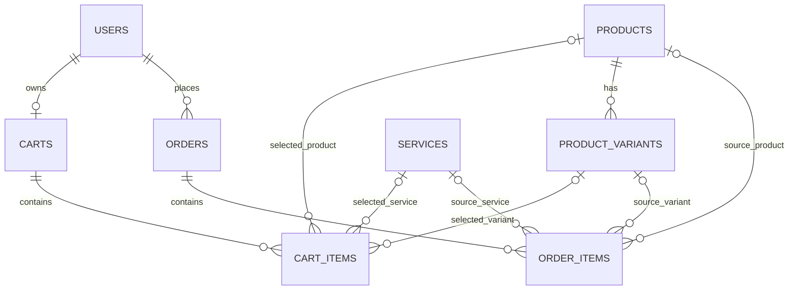
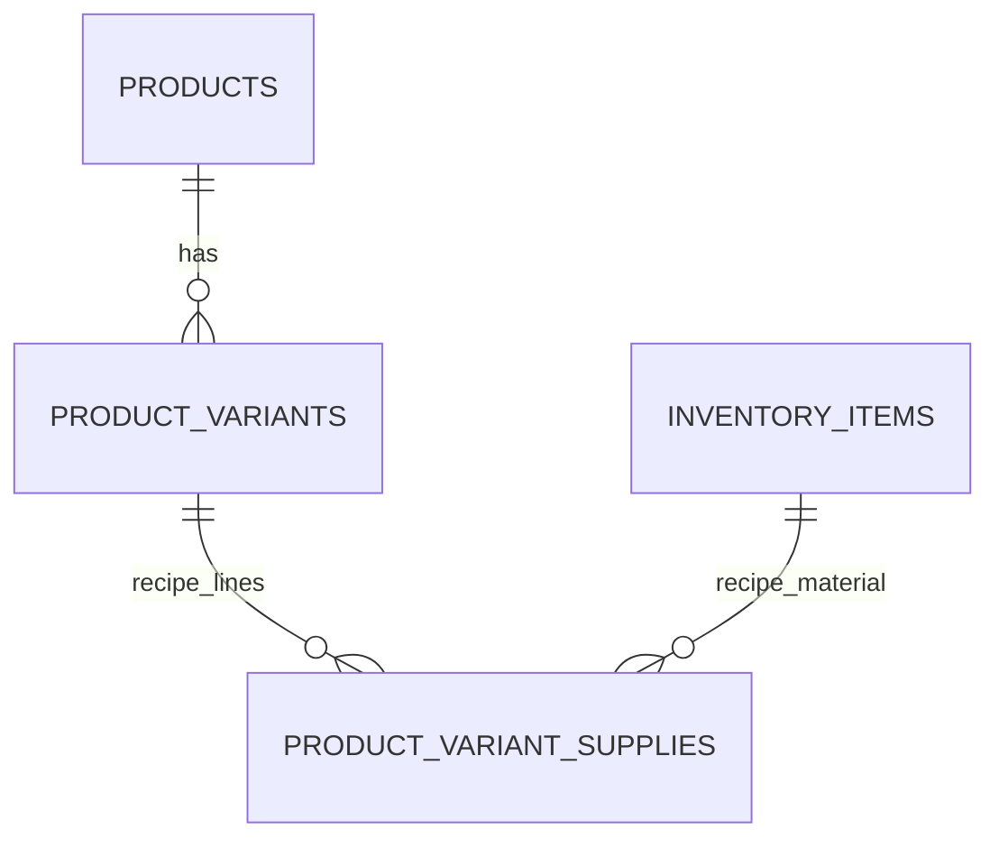
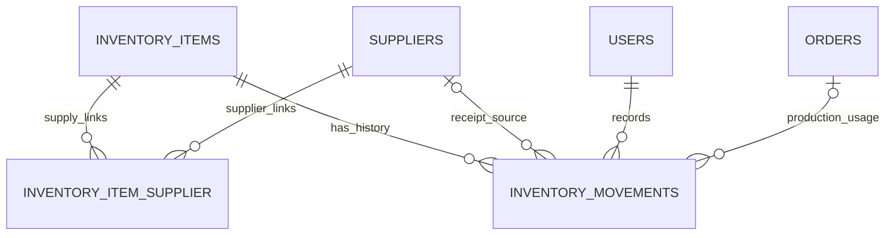

# GZSLP-MS System Design

**Document type:** Living, repository-local system design description  
**Source:** ENGGSF2 Software Design Document, Prelim Design Check, dated 2026-08-22  
**Last reviewed:** 2026-10-23
**Implementation status:** Early MVP; this document distinguishes implemented behavior from proposed work.

This document mirrors the supplied SDD's organization while describing the application as it exists in this repository. It is not a replacement for the course SDD or the approved SRS. Keep the course document and this implementation record aligned as requirements and code change.

## Status Legend

- **Implemented:** Present in the application and covered by automated tests.
- **Partial:** Some foundational behavior exists, but the SDD capability is incomplete.
- **Planned:** Required or described by the SDD but not implemented in the current application.
- **Decision needed:** The source documents or current model leave a consequential design choice unresolved.

## 1. Introduction

### 1.1 Purpose

Record the current architecture, data, interfaces, security boundaries, implementation state, and next development work for GZSLP-MS. Developers should update this file when a feature, schema, or system boundary changes.

### 1.2 Scope

The SDD describes an online selling platform for Graphic Zone's printing services. Customers should be able to request quotations for supplied designs and customize services. Employees should manage offered services, accounts, orders, inventory, and reports. The SDD excludes the rice retail operation and an AI chatbot.

The current code is an early Laravel storefront foundation: customer/employee/admin accounts, profile and password management, verification/reset flows, employee shop operations, admin account/report controls, searchable product/service catalogs, persisted carts, order submission/tracking, and raw-supply inventory linked to finished-product variants. Payment processing remains outside the current implementation.

### 1.3 Terms

| Term | Meaning in this document |
|---|---|
| Customer | A registered account with the `customer` role. |
| Employee | An account with the `employee` role; may manage shop operations but not accounts or reports. |
| Admin | An account with the `admin` role and access to shop operations, account management, and reports. |
| Product | A finished item in the catalog, such as a paper product, mug, shirt, tarpaulin, or custom product. Paper specifications are optional and apply only to paper products. |
| Service | A printing or design service in the catalog; a starting price may be unspecified. |
| Set design | A pre-created product listing customers can order; no separate design entity is used in this version. |
| Custom design | Customer-supplied artwork attached privately to an order, optionally paired with a quote-only service. |

### 1.4 Document Overview

Sections 2-5 describe references, architecture, modules, and dependencies. Sections 6-8 describe interfaces, data, and detailed behavior. Section 9 maps requirements to implementation evidence. Appendix A records implementation decisions and revisions.

## 2. References

- Cabrera, G. et al. (2026). *Graphic Zone Software Requirements Specification*. Internal, unpublished course deliverable, as cited by the supplied SDD.
- University of Baguio, School of Information Technology. (2026-08-22). *Graphic Zone Sustainable Livelihood Program – Management System: Software Design Document*, Prelim Design Check.
- IEEE Std 1016-2009, *Systems Design—Software Design Descriptions*.
- Laravel 12 application code and feature tests in this repository.

## 3. Architectural Design

### 3.1 Logical View

The application uses Laravel's server-rendered MVC style:

1. A browser requests a named route.
2. Route middleware checks guest/authenticated/admin access.
3. A controller or route action validates/loads application data through Eloquent models.
4. A Blade view renders HTML; Vite supplies CSS and JavaScript assets.
5. Laravel's configured SQL connection persists records.

The main code locations are `routes/web.php`, `app/Http/Controllers`, `app/Http/Requests`, `app/Models`, `resources/views`, and `database/migrations`.

### 3.2 Physical View

Users access the app through a web browser. Laravel/PHP and the web server handle application logic; SQLite is the current local database configuration. Production database, hosting, backups, and deployment topology are not specified in this repository and remain deployment decisions.

The application uses Vite with Tailwind CSS for compiled frontend assets. No payment gateway, SMS provider, or custom email integration is currently implemented.

## 4. Decomposition Description

### 4.1 Module Decomposition and Status

| Module | Current status | Present behavior | Remaining work from the SDD |
|---|---|---|---|
| Account management | Partial | Customer registration, login/logout, profile/phone/password editing, email verification/reset, active-state protection, and customer/employee/admin roles. Admins create/update/deactivate accounts and may delete accounts without order or inventory history; self-deletion and deletion of the last active admin are blocked. | Verification is advisory, not required for shopping; audit trail, fine-grained staff permissions, and broader privacy workflows remain. |
| Product catalog | Partial | Employee/admin create/list/edit/delete; optional public image, paper/mug/shirt/tarpaulin/custom categories, default and custom option variants, and per-variant pricing. Variant recipes derive current finished-unit availability from on-hand supplies; customers see availability on product details. | Advanced discovery, price-changing variant bundles, and broader product metadata remain. |
| Service management | Partial | Employee/admin create/list/edit/delete; optional public image, starting price/visibility and stale-edit protection. Customers search/view details and add priced/quote-only services. Orders support private custom-artwork uploads. | Multi-message quote conversation, estimate/fulfillment workflow, richer service options. |
| Cart management | Partial | Each customer has a persisted cart; add products/services, merge repeated adds, update/remove quantities, show item count, and calculate prices from current catalog records. Product cart lines carry the selected variant and variant price; cart changes validate aggregate raw-supply requirements against current stock; quote-only services show a pre-quote subtotal. Inventory is not reserved in the cart. | Cart customization/options, quote request submission, payment, and inventory reservation. |
| Order management | Partial | Customers submit carts with notes and optional private artwork, view their own history/details, and cancel eligible requests. Admins review orders, download artwork, send quotes, and advance status. Order lines preserve catalog snapshots including the selected product variant and encoded options. | Payment, more advanced fulfillment estimates, shipping/address data, notifications, and richer staff workflows. |
| Transaction processing | Planned | No payment or transaction records/integration. | Payment method selection, transaction validation, status recording, staff-recorded manual payment and/or gateway integration. |
| Inventory management | Partial | Staff track raw supplies separately from finished catalog products; suppliers link to supplies; receipts, usage and stocktakes are recorded with balance history; low-stock items are flagged. Product variant availability is calculated from its supply recipe and current balances. Production start consumes each product variant’s recipe once, and insufficient stock blocks the transition. | Purchase orders/cost valuation, deeper fulfillment/status reporting, and inventory-driven quote rules remain. |
| Report generation | Partial | Admin-only date-filtered order activity report with status counts, completed-order count/value, catalog active/hidden counts, pagination, and browser print. Completed-order value is not marked as paid revenue. | True sales report requires transaction/payment records; inventory report requires stock/supplier data. CSV/PDF export and additional performance measures remain. |
| Customer storefront | Partial | Auth overlays, protected navigation, searchable/paginated product/service catalog with images/details, cart/order flow, set designs as products and private custom-artwork attachment. Product details show per-variant inventory-derived quantities and disable sold-out options. | Payment/fulfillment flow and broader product discovery remain. |

### 4.2 Current Key Processes

**Registration:** Guest submits name, email, optional phone, password, and confirmation. A Form Request validates the input; registration creates an active customer account, dispatches Laravel's registered event for email verification, logs it in, regenerates the session, and redirects to the customer account page. Role is not accepted from public input.

**Login:** Guest submits email/password. The login Form Request validates credentials, applies a five-failure rate limit keyed by normalized email and IP, authenticates only active accounts, regenerates the session, and routes employees/admins to shop management and customers to their account.

**Catalog management:** An employee/admin submits a create/update form. A role-aware Form Request authorizes and validates fields. Updates compare the submitted `lock_version` with the current database version, increment on success, and reject stale changes. Delete uses a CSRF-protected DELETE form. Products support paper, mug, shirt, tarpaulin, and custom categories, with paper specifications limited to paper products. Each product can have multiple `product_variants`, each with a price, option fields, and optional raw-supply recipe. A default `Standard` variant preserves compatibility with products that have no custom variants.

**Customer catalog viewing:** Active authenticated users request Products or Services. Routes query only `is_active` records, support search/filter and pagination, and expose individual detail pages. Guests are redirected to login. Product details calculate each variant's available finished-unit quantity from the minimum producible quantity across its active supply recipe; variants without a recipe are labeled as not inventory-tracked. Sold-out options cannot be selected.

**Cart management:** An authenticated non-admin customer adds an active product/service with a quantity from 1 to 99. The application creates or reuses that customer's cart and combines repeated additions of the same catalog entry. Product cart lines include the selected `product_variant_id`, which keeps the chosen option set and variant price in the cart. Additions and quantity updates check the combined supply requirements for all product lines against current stock in a transaction. Quantity updates and removal are scoped to the authenticated user's cart. The cart reads the current catalog price and calculates amounts in integer cents. Quote-only services remain in the cart but make the final total pending; the view shows a pre-quote subtotal. Cart contents do not reserve inventory, so production-start validation remains authoritative if stock changes after a cart update.

**Order submission:** A customer submits a non-empty cart with an optional note. Within one database transaction, the system locks the cart and lines, rechecks that catalog entries remain active, calculates the subtotal from current catalog prices, creates the order and immutable name/description/price/quantity/product-variant snapshots, then clears the cart. If a catalog item became inactive, the transaction is rejected and the cart remains intact. Inventory is not reserved at order submission; production start validates the recipe against the then-current stock. A cart containing a quote-only service creates a `quote_requested` order with a pre-quote subtotal and no final total.

Customers may also attach one JPG, PNG, or PDF artwork file (up to 10 MB) to the order. It is stored on Laravel's private local disk and is not served through a public URL. Customer downloads are scoped to the customer's order; staff downloads are behind the shop-management Gate. If order creation fails, the just-uploaded file is removed.

**Order tracking and administration:** Customers can list and view only their own orders. They may cancel orders in `pending`, `quote_requested`, or `quote_sent`; later statuses cannot be customer-cancelled. Admin status transitions are constrained: `pending` to `processing`/`cancelled`; `quote_requested` to `quote_sent`/`cancelled`; `quote_sent` to `cancelled`; `processing` to `completed`/`cancelled`. A customer must explicitly accept a sent quote, which records `customer_accepted_at` and moves the order to `processing`. Sending a quote requires a valid quoted total. Moving an order into `processing` now also consumes the selected product variant's supply recipe once, and missing stock rejects the transition. This keeps stock deduction tied to production-start rather than to cart submission.

**Account maintenance:** Customers update their own contact details/password; email changes clear verification. Laravel verification and password-reset flows use configured notifications. Admins create/update/deactivate accounts and may delete accounts with no order or inventory-movement history. Accounts with historical records must be deactivated to preserve ownership/audit links; admins cannot delete their current account or the last active administrator. Employees can manage shop operations but cannot manage accounts or view reports. Verification currently prompts but does not block shopping.

**Concurrency:** Product and service edit forms submit `lock_version`. If another employee/admin has saved first, the stale request is rejected with a reload/reapply message instead of overwriting the newer record. Product variants also use `lock_version` when edited so the price/recipe update is not overwritten by a stale form.

**Supply inventory:** Staff create supply records with category, unit, reorder threshold and optional suppliers. New records start at zero. Receipts add quantity and require a supplier; usage subtracts quantity and cannot make stock negative; stocktakes set the balance to a physical count. Each movement locks the item in a database transaction, updates its balance and appends a before/after record with the acting user. Low stock means an active supply at or below its reorder threshold. Product variants can define a supply recipe: current availability is the minimum number of finished units producible across the recipe's supplies. Cart changes validate aggregate recipes against current balances. Production start is atomic: if the required material is not available, the order stays in its current status and no stock is deducted.

## 5. Dependency Description

| Component | Depends on | Type | Reason / status |
|---|---|---|---|
| Account/auth | Laravel authentication, sessions, users table | Internal/framework | Registration, authentication, authorization, and session lifecycle. Implemented. |
| Admin catalog | Account/auth Gate `manage-shop`, Product/Service models | Internal | Restricts catalog changes to employees/admins; optimistic versions protect concurrent edits. Implemented at CRUD level. |
| Customer catalog | Product/Service models and authenticated session | Internal | Shows active listings only to signed-in customers. Implemented. |
| Cart | Account, product/service catalog, product variants | Internal | Partially implemented; customer Gate, ownership-scoped cart records, active checks, selected-variant pricing, and server-side pricing are in place. |
| Orders | Account, cart, product/service catalog, product variants | Internal | Partially implemented; cart ownership, availability recheck, price calculation, snapshots, order history, and status workflows are in place. Variant recipe stock consumption starts at production, and payment remains separate. |
| Transactions | Orders and selected payment method/provider | Internal/external | Planned; no payment integration is installed. Provider and manual payment scope need decisions. |
| Inventory | Products, product variants, suppliers, raw-supply recipes and movement records | Internal | Partial; raw supply model and variant consumption rules are in place, but purchase-order/cost valuation and broader fulfillment tracking remain open. |
| Supply inventory | Suppliers, staff accounts, inventory movement ledger, product variant recipes | Internal | Partial; receipts/usage/stocktakes, low-stock thresholds, and production-time consumption are tracked. |
| Reports | Orders and product/service catalog; future transactions/inventory | Internal | Partial; current report reads order/catalog records and is admin-only. Paid revenue and stock reports await their source modules. |
| Account administration | Admin-only Gate and User model | Internal | Admins create/update/deactivate accounts and delete only records without order or inventory history. |
| Email/SMS | Mail or SMS provider | External | Mentioned by the SDD but not configured as a product workflow. Provider, cost, and notification requirements are open. |
| Persistence | SQLite locally; SQL database abstraction | External/runtime | Laravel database connection. Production database not yet specified. |
| Frontend build | Vite, Tailwind CSS | Build-time | Compiles CSS/JS used by Blade pages. |

## 6. Interface Description

### 6.1 User Interfaces

| Interface | Users | Current exchange / behavior | Status |
|---|---|---|---|
| Storefront home | Guest/customer | Shows print-shop introduction; guests see login/register; signed-in customers see catalog links. Admins are redirected to admin dashboard. | Partial |
| Login overlay | Guest | Email, password, optional remember-me; validation and credential errors return to overlay. | Implemented |
| Registration overlay | Guest | Name, email, password, confirmation; successful signup creates customer role. | Implemented |
| Customer Products | Active authenticated account | Search/filter active paper products, paginate, view detail and add product/quantity to cart. | Partial |
| Customer Services | Active authenticated account | Search services, view details, add priced services or request a quote. | Partial |
| Cart | Authenticated customer | Add product/service, change quantity, remove items, view subtotal, add an optional shop note, and submit an order or quote request. Payment checkout is not present. | Partial |
| Customer order history/details | Authenticated customer | View own order status, item snapshots, subtotal/quote, shop notes, and cancel an eligible order. | Partial |
| Admin order management | Admin | Review all submitted orders, send a quoted total, add customer-facing note, and perform allowed status transitions. | Partial |
| Admin order report | Admin | Filter order activity by date range; see order statuses, completed order value, and active/hidden catalog counts; browser print. | Partial |
| Customer account settings | Active account | Edit own name/email/phone; change password after current-password check. | Partial |
| Admin account management | Admin | Search/filter users; create/update customer, employee, admin roles; deactivate; protect last active admin. | Partial |
| Staff supply inventory | Employee/admin | Create/edit/deactivate supplies and suppliers; receive/use/stocktake; review low stock and movement history. | Partial |
| Admin dashboard | Employee/admin | Links to shop operations; Reports/Accounts visible only to admin. | Partial |
| Admin product/service management | Employee/admin | List, create, edit, hide/show, delete; stale updates are rejected. | Implemented at CRUD level |

### 6.2 External and Internal Interfaces

No payment, SMS, or custom email API is called. Internal route authorization uses Laravel's `auth`, `guest`, and `can:access-admin` middleware. Form Requests enforce validation/authorization, controllers use Eloquent models, and Blade templates display data.

## 7. Data Design

### 7.1 Current Entities and Relationships

The canonical attribute-level ERD is maintained in [`erd.mmd`](./erd.mmd). It contains all 13 application data tables, uses the SQLite `INTEGER`, `VARCHAR`, `DECIMAL`, `TEXT`, `JSON`, `BOOLEAN`, `TIMESTAMP`, and `DATETIME` type names, and marks primary, foreign, and unique keys. The relationships are split below into bounded views for legibility; together they cover the full schema.

**Accounts, cart, and order snapshots**

**Product recipes and raw supplies**

**Supplier and movement history**

`users` has a one-to-zero-or-one relationship with `carts` (`carts.user_id` is unique), and one-to-many relationships with `orders` and `inventory_movements`. A cart and an order can have zero or more lines at the database level; the order-submission workflow rejects empty carts. Each cart/order line is intended to reference exactly one product or service. This XOR rule is validated in application code, not by a database `CHECK`; that is a deliberate portable-schema choice and remains a documented integrity boundary.

Every product has a default variant created by the application, and a product may have additional variants. Product and variant prices are maintained together for the default variant; the variant is the selected product's price source. `product_id` remains on product cart/order lines in addition to `product_variant_id`: carts need the product FK's cascade-delete behavior, and order snapshots retain a nullable direct catalog link when variant/catalog records are removed. Order-item display, price, paper, and variant values are snapshots; nullable catalog references use `ON DELETE SET NULL` so the order history survives catalog deletion.

`inventory_item_supplier` and `product_variant_supplies` are explicit composite-key join tables, not implicit many-to-many lines. A recipe row records the raw quantity needed per finished variant. `inventory_movements` is append-only through application workflows and records before/after balances, actor, and optional supplier/order references. When production starts, the application checks required quantities while holding database locks and rejects a deduction that would make stock negative; the current schema does not declare a portable database `CHECK (quantity_on_hand >= 0)`. Inventory item categories and status/type/role columns are strings with application-validated allowed values, not database enums. Payment/address entities are absent.

### 7.2 Current Data Dictionary

The dictionary below reflects the migrations. For the SQLite-backed implementation, Laravel `id` and `foreignId` columns are represented as `INTEGER`; `string` is `VARCHAR(255)` unless a length is shown; timestamp columns retain the migration's timestamp/datetime distinction. DECIMAL precision and scale are stated explicitly. `NOT NULL`, `NULL`, defaults, indexes, uniqueness, FK targets, and delete behavior are part of each field's constraint description.

| Table | Field | Type / constraint | Meaning |
|---|---|---|---|
| `users` | `id` | INTEGER, PK, auto-generated | Account identifier. |
| `users` | `name` | VARCHAR(255), NOT NULL | Display name. |
| `users` | `email` | VARCHAR(255), NOT NULL, UNIQUE | Login identifier. |
| `users` | `password` | VARCHAR(255), NOT NULL | Credential hash; hashed by model cast. |
| `users` | `role` | VARCHAR(255), indexed, NOT NULL, default `customer` | Authorization role: `customer`, `employee`, or `admin`; application validation restricts values and public signup cannot assign it. |
| `users` | `phone` | VARCHAR(25), NULL | Optional contact number. |
| `users` | `is_active` | BOOLEAN, NOT NULL, DEFAULT true, indexed | Inactive accounts cannot sign in or access protected account/store routes. |
| `users` | `email_verified_at` | TIMESTAMP, NULL | Email verification time. |
| `users` | `remember_token` | VARCHAR(100), NULL | Framework remember-me token. |
| `users` | `created_at`, `updated_at` | DATETIME, NULL | Framework account creation/update times. |
| `products` | `id` | INTEGER, PK, auto-generated | Catalog identifier. |
| `products` | `name` | VARCHAR(255), NOT NULL | Product title. |
| `products` | `description` | TEXT, NULL | Product details. |
| `products` | `category` | VARCHAR(255), NOT NULL, default `paper`, indexed | Finished-item category such as `paper`, `mug`, `shirt`, `tarpaulin`, or `other`; application validation restricts values. |
| `products` | `price` | DECIMAL(10,2), NOT NULL, default 0 | Base/default price mirror for the standard variant; product/default-variant update flows keep the values synchronized. |
| `products` | `paper_size`, `paper_weight`, `paper_finish` | VARCHAR(80) each, NULL | Optional paper specifications for legacy paper-based products; cleared for non-paper category. |
| `products` | `image_path` | VARCHAR(255), NULL | Path to optional catalog image on the public storage disk. |
| `products` | `is_active` | BOOLEAN, NOT NULL, DEFAULT true, indexed | Whether customers can see the product. |
| `products` | `lock_version` | INTEGER, NOT NULL, DEFAULT 0, unsigned in migration | Optimistic concurrency version for catalog edits. |
| `products` | `created_at`, `updated_at` | DATETIME, NULL | Record creation/update times. |
| `product_variants` | `id` | INTEGER, PK, auto-generated | Product option/variant identifier. |
| `product_variants` | `product_id` | NOT NULL INTEGER; FK to `products.id`, ON DELETE CASCADE | Parent product. |
| `product_variants` | `name` | VARCHAR(255), NOT NULL | Required customer-visible variant name such as `Large / Black`. |
| `product_variants` | `sku` | VARCHAR(255), nullable, UNIQUE | Optional stock code; unique when supplied. |
| `product_variants` | `options` | JSON, nullable | Customer-visible option values such as size, color, or dimensions; application accepts at most 8 string values, each at most 80 characters. |
| `product_variants` | `price` | DECIMAL(10,2), NOT NULL | Variant-specific price charged when this option is selected. |
| `product_variants` | `is_default` | BOOLEAN, NOT NULL, default false | Marks the default variant; application workflows create and maintain a default variant. |
| `product_variants` | `is_active` | BOOLEAN, NOT NULL, default true, indexed | Inactive variants are hidden from customers. |
| `product_variants` | `lock_version` | INTEGER, NOT NULL, DEFAULT 0, unsigned in migration | Optimistic concurrency version for variant edits. |
| `product_variants` | `created_at`, `updated_at` | DATETIME, NULL | Created/updated times. |
| `product_variant_supplies` | `product_variant_id` | INTEGER; FK to `product_variants.id`, ON DELETE CASCADE | First column of the composite primary key. |
| `product_variant_supplies` | `inventory_item_id` | INTEGER; FK to `inventory_items.id`, ON DELETE RESTRICT | Second column of the composite primary key. |
| `product_variant_supplies` | `quantity_per_unit` | NOT NULL DECIMAL(12,3) | Raw material quantity needed for one finished unit; application requires a positive quantity. |
| `services` | `id` | INTEGER, PK, auto-generated | Service identifier. |
| `services` | `name` | VARCHAR(255), NOT NULL | Service title. |
| `services` | `description` | TEXT, NULL | Service details. |
| `services` | `starting_price` | DECIMAL(10,2), NULL | Starting price; null renders as quote required. |
| `services` | `image_path` | VARCHAR(255), NULL | Path to optional service image on the public storage disk. |
| `services` | `is_active` | BOOLEAN, NOT NULL, DEFAULT true, indexed | Whether customers can see the service. |
| `services` | `lock_version` | INTEGER, NOT NULL, DEFAULT 0, unsigned in migration | Optimistic concurrency version; stale service edits are rejected. |
| `services` | `created_at`, `updated_at` | DATETIME, NULL | Record creation/update times. |
| `carts` | `id` | INTEGER, PK, auto-generated | Cart identifier. |
| `carts` | `user_id` | NOT NULL INTEGER; UNIQUE; FK to `users.id`, ON DELETE CASCADE | The customer who owns this cart; at most one cart per account. |
| `carts` | `created_at`, `updated_at` | DATETIME, NULL | Cart creation/update times. |
| `cart_items` | `id` | INTEGER, PK, auto-generated | Cart line identifier. |
| `cart_items` | `cart_id` | NOT NULL INTEGER; FK to `carts.id`, ON DELETE CASCADE | Parent cart. |
| `cart_items` | `product_id` | Nullable FK to `products.id`, ON DELETE CASCADE | Product target when the line is a product. |
| `cart_items` | `product_variant_id` | Nullable FK to `product_variants.id`, ON DELETE SET NULL | Selected product variant for that cart line. |
| `cart_items` | `service_id` | Nullable FK to `services.id`, ON DELETE CASCADE | Service target when the line is a service. |
| `cart_items` | `quantity` | INTEGER, NOT NULL, unsigned, DEFAULT 1 | Requested quantity; application validation limits it to 1-99. |
| `cart_items` | `(cart_id, product_variant_id)` | UNIQUE composite index | Prevents duplicate selections of the exact same product variant in one cart. |
| `cart_items` | `(cart_id, service_id)` | UNIQUE composite index | Prevents duplicate service lines in one cart. |
| `cart_items` | `created_at`, `updated_at` | DATETIME, NULL | Line creation/update times. |
| `orders` | `id` | INTEGER, PK, auto-generated | Order identifier. |
| `orders` | `user_id` | NOT NULL INTEGER; FK to `users.id`, ON DELETE RESTRICT | Customer who placed the order. |
| `orders` | `status` | VARCHAR(255), NOT NULL, indexed, DEFAULT `pending` | Workflow value: `pending`, `quote_requested`, `quote_sent`, `processing`, `completed`, or `cancelled`; application validates transitions. |
| `orders` | `subtotal` | DECIMAL(10,2), NOT NULL, DEFAULT 0 | Sum of priced line snapshots at submission; quote-only lines are excluded. |
| `orders` | `quoted_total` | DECIMAL(10,2), NULL | Admin-provided total; required by application when status becomes `quote_sent`. |
| `orders` | `customer_accepted_at` | TIMESTAMP, NULL | Time the customer accepted the quoted total. |
| `orders` | `artwork_path` | Nullable string | Path to customer artwork on private local storage; download uses authorization-scoped routes. |
| `orders` | `inventory_consumed_at` | Nullable TIMESTAMP | Idempotency marker set after the order's raw-supply recipe has been consumed. |
| `orders` | `customer_note`, `admin_note` | TEXT, NULL | Customer instructions and customer-visible staff update. |
| `orders` | `created_at`, `updated_at` | DATETIME, NULL | Order creation/update times. |
| `order_items` | `id` | INTEGER, PK, auto-generated | Order-line identifier. |
| `order_items` | `order_id` | NOT NULL INTEGER; FK to `orders.id`, ON DELETE CASCADE | Parent order. |
| `order_items` | `product_id` | Nullable FK to `products.id`, ON DELETE SET NULL | Optional source product; purchase snapshot remains if the product is deleted. |
| `order_items` | `product_variant_id` | Nullable FK to `product_variants.id`, ON DELETE SET NULL | Optional source variant; purchase snapshot remains if the variant is deleted. |
| `order_items` | `service_id` | Nullable FK to `services.id`, ON DELETE SET NULL | Optional source service; purchase snapshot remains if the service is deleted. |
| `order_items` | source XOR rule | Application constraint | Exactly one of product or service is required; product lines also carry their selected variant when available. No database check currently enforces this rule. |
| `order_items` | `item_name` | VARCHAR(255), NOT NULL | Purchase-time item-name snapshot. |
| `order_items` | `item_description` | TEXT, NULL | Purchase-time description snapshot. |
| `order_items` | `unit_price` | DECIMAL(10,2), NULL | Purchase-time unit price; null denotes an item requiring a quote. |
| `order_items` | `quantity` | INTEGER, NOT NULL, unsigned in migration | Quantity submitted from cart. |
| `order_items` | `variant_name` | Nullable VARCHAR(255) | Selected product variant name, such as `Large / Black`; purchase-time snapshot. |
| `order_items` | `variant_options` | Nullable JSON | Selected option details captured at order submission; deliberate purchase-time snapshot. |
| `order_items` | `paper_size`, `paper_weight`, `paper_finish` | VARCHAR(80) each, NULL | Product paper-option snapshots. |
| `order_items` | `created_at`, `updated_at` | DATETIME, NULL | Order-line created/updated times. |
| `suppliers` | `id` | INTEGER, PK, auto-generated | Supplier identifier. |
| `suppliers` | `name` | VARCHAR(255), NOT NULL | Supplier name. |
| `suppliers` | `email`, `address` | VARCHAR(255), NULL | Supplier email and address. |
| `suppliers` | `phone` | VARCHAR(25), NULL | Supplier contact phone. |
| `suppliers` | `is_active` | BOOLEAN, NOT NULL, DEFAULT true, indexed | Whether staff can select the supplier for new receipts; historical movements remain. |
| `suppliers` | `created_at`, `updated_at` | DATETIME, NULL | Supplier timestamps. |
| `inventory_items` | `id` | INTEGER, PK, auto-generated | Raw-supply identifier. |
| `inventory_items` | `name` | VARCHAR(255), NOT NULL | Supply name; separate rows can represent sizes/colors. |
| `inventory_items` | `sku` | VARCHAR(255), NULL, UNIQUE | Optional stock code. |
| `inventory_items` | `category` | NOT NULL VARCHAR(255), indexed | Application-validated values: `paper`, `blank_mug`, `blank_shirt`, `tarpaulin_material`, `ink`, or `other`. |
| `inventory_items` | `unit` | VARCHAR(32), NOT NULL | Counting unit, for example sheet, piece, meter, roll, or bottle. |
| `inventory_items` | `quantity_on_hand` | DECIMAL(12,3), NOT NULL, DEFAULT 0 | Current supply balance; changed through movement recording; application invariant is non-negative. |
| `inventory_items` | `reorder_level` | DECIMAL(12,3), NOT NULL, DEFAULT 0 | Active supplies at/below this level are low stock. |
| `inventory_items` | `is_active` | BOOLEAN, NOT NULL, DEFAULT true, indexed | Inactive supply record is retained but excluded from active operations. |
| `inventory_items` | `lock_version` | INTEGER, NOT NULL, DEFAULT 0, unsigned in migration | Optimistic locking for metadata edits. |
| `inventory_items` | `created_at`, `updated_at` | DATETIME, NULL | Record creation/update times. |
| `inventory_item_supplier` | `inventory_item_id` | INTEGER; FK to `inventory_items.id`, ON DELETE CASCADE | First column of the composite primary key. |
| `inventory_item_supplier` | `supplier_id` | INTEGER; FK to `suppliers.id`, ON DELETE CASCADE | Second column of the composite primary key; together the columns uniquely associate one supplier with one supply. |
| `inventory_movements` | `id` | INTEGER, PK, auto-generated | Stock movement identifier. |
| `inventory_movements` | `inventory_item_id` | NOT NULL INTEGER; FK to `inventory_items.id`, ON DELETE RESTRICT | Supply whose balance changed. |
| `inventory_movements` | `supplier_id` | Nullable INTEGER; FK to `suppliers.id`, ON DELETE SET NULL | Supplier associated with a receipt. |
| `inventory_movements` | `user_id` | NOT NULL INTEGER; FK to `users.id`, ON DELETE RESTRICT | Staff member who recorded the movement. |
| `inventory_movements` | `order_id` | Nullable INTEGER; FK to `orders.id`, ON DELETE SET NULL | Order whose production start triggered a material usage deduction. |
| `inventory_movements` | `type` | VARCHAR(255), NOT NULL | Application-validated values: `received`, `used`, or `stocktake`. |
| `inventory_movements` | `quantity_change` | NOT NULL DECIMAL(12,3), signed | Balance delta; received is positive, used is negative, and stocktake is counted balance minus prior balance. |
| `inventory_movements` | `quantity_before`, `quantity_after` | NOT NULL DECIMAL(12,3) each | Balance before/after movement for audit; movement workflow maintains after = before + change. |
| `inventory_movements` | `notes` | Nullable text | Receipt reference, usage reason, count notes, or production-order reference. |
| `inventory_movements` | `created_at` | NOT NULL TIMESTAMP, default current time | Movement timestamp; indexed with `inventory_item_id`; application exposes append-only movements. |

`inventory_items.quantity_on_hand` has the application invariant `quantity_on_hand >= 0`: stock updates execute in a transaction, lock the inventory row, and reject a negative resulting balance. There is no database `CHECK` constraint in the current migration, so non-application writers must enforce this rule too.

### 7.3 Normalization Review

The schema was reviewed against first, second, and third normal forms (1NF-3NF):

- **1NF:** Table columns hold one value per row except the JSON `product_variants.options` and `order_items.variant_options` payloads. These are deliberate, bounded option-map and purchase-snapshot exceptions; option data is not currently queried as relational data. If option-level search/reporting becomes necessary, move options to normalized definition/value tables.
- **2NF:** Both many-to-many relationships have explicit composite-key tables. In `product_variant_supplies`, `quantity_per_unit` depends on the complete `(product_variant_id, inventory_item_id)` key. The supplier association has no non-key attributes.
- **3NF:** Products, variants, services, users, suppliers, inventory items, orders, and movement history are separate entities. Repeated category, role, status, and movement-type values are small, application-validated vocabularies rather than copied descriptive data; lookup tables are not currently warranted.
- **Deliberate redundancy and snapshots:** `products.price` mirrors the default variant price for legacy product forms/fallbacks and is synchronized by the product/default-variant update workflows; variant price drives selected-variant cart pricing. `orders.subtotal` is captured at order submission as the sum of priced line snapshots (quote-only lines are excluded), so later catalog edits do not change the order's submitted amount. `order_items` deliberately snapshots names, descriptions, price, paper attributes, and variant options while retaining nullable source FKs, preserving history after catalog edits/deletions.
- **Application-enforced line integrity:** Cart/order lines require exactly one product or service in application workflows. The current portable schema does not encode this XOR as a database check; adding a supported check in the production database is a future hardening item.

**Future data design decisions:**

- Cart and cart-item ownership/quantity/target are implemented. The target XOR remains application-enforced; add a database check if supported database engines are finalized and independent database enforcement is required.
- Order and order-item records/snapshots are implemented. Still decide shipping/address, estimated completion, inventory reservation, and payment fields before extending checkout.
- Payment/transaction records should reference an order and capture amount, method, status, and provider reference; never store payment secrets.
- Supplies are tracked separately from finished products. Product variants define their own material consumption rates; the next design decision is whether one product can have multiple active recipes or whether recipes should be locked to a single approved production method.
- Addresses and notification preferences are not current user fields.

**SDD consistency notes:** The supplied data dictionary names both `Transaction Details` and `Transactions` in ways that appear reversed or conflated. Before building those tables, agree on distinct `orders`, `order_items`, and `payments`/`transactions` entities and update the course ERD/data dictionary. The SDD also includes size/material pivots that may describe apparel better than the current paper-print scope; do not implement these without confirming they apply.

## 8. Detailed Design

### 8.1 Component Design

- Laravel resource routes provide the admin catalog CRUD endpoints, except `show`.
- Product and service Form Requests own validation and require the `manage-shop` Gate.
- Public registration uses a dedicated Form Request and never accepts role assignment from the request.
- Email verification and password reset use Laravel notification/password broker flows; verification prompts but does not currently gate shopping.
- Customer profile routes are owner-scoped; admin account management is admin-only, preserves accounts linked to order or inventory history, and protects the current/last active administrator from deletion.
- Product/service updates compare and increment `lock_version` to reject stale forms.
- Product/service images are MIME-validated and stored on the public disk; replaced/deleted catalog images are removed.
- Customer artwork is MIME/size-validated and stored on the private local disk; only the owning customer or authorized staff can download it.
- The admin seeder reads credentials from environment-backed config; secrets must not be committed.
- Customer catalog routes query active records and are behind authentication middleware.
- Cart routes are protected by the `access-customer` Gate; item lookup is scoped through the signed-in user's cart.
- Order submission is transactional and locks the cart/lines while it checks active catalog records, copies snapshots, creates the order, and clears cart lines.
- Customer order routes scope lookups through the authenticated user's `orders()` relation; admin order routes are protected by `access-admin`.
- Inventory movements use a row-locked transaction, reject negative balances, update `quantity_on_hand`, and append before/after balance history. Suppliers can be deleted; inventory movement records remain and their supplier reference is nulled.
- Feature tests use SQLite `:memory:` and `RefreshDatabase`; they do not modify the developer's local database file.

### 8.2 HCI / UI-UX Notes

- Auth forms render in modal overlays with close controls, Escape-to-close, focus management, and validation feedback.
- Customer navigation hides Products/Services/Cart from guests; server routes independently enforce authentication.
- Customer catalogs provide search/filter, pagination and item detail pages.
- Catalog pages render optional uploaded images; the order form accepts optional private artwork.
- Admin create/edit forms show validation errors beside fields and provide cancel navigation.
- Catalog records have explicit visibility controls; deletion requires browser confirmation.
- The current UI is a functional baseline. Cart has empty, quote-required, unavailable-item, validation, and priced-subtotal states. Order history/detail and admin queue show current statuses; payment checkout/confirmation remains to be designed.

## 9. Requirements Traceability Matrix

| Requirement / capability | SDD location | Design element | Evidence | Status |
|---|---|---|---|---|
| Register/manage accounts and roles | 4.1 Account Management; 6 Account interfaces | Auth/profile/password controllers, admin User resource, active/role Gates | `tests/Feature/AccountManagementTest.php`; auth feature tests | Partial: audit/privacy workflow remains |
| Email verification and password reset | 5 Dependencies; 6 Email interface | Laravel verification/password broker notifications | `tests/Feature/AccountManagementTest.php` | Implemented; verification is not enforced for shopping |
| Separate customer, employee and admin access | 4.1 Account Management | User roles and `access-customer`, `manage-shop`, `access-admin` Gates | Account and catalog feature tests | Implemented baseline permissions |
| Add/edit/remove/view services | 4.1 Service Management | Employee/admin Service resource, image upload, optimistic lock, customer search/detail | `tests/Feature/CatalogManagementTest.php`; `tests/Feature/CustomerCatalogTest.php` | Partial: option/quote conversation remains |
| Add/edit/remove/view products | 4.1 Cart/Inventory context; 7 Data Design | Employee/admin Product resource, category fields, default/selected variants, image upload, optimistic lock, customer search/detail | `tests/Feature/CatalogManagementTest.php`; `tests/Feature/CustomerCatalogTest.php`; `tests/Feature/ProductVariantManagementTest.php` | Partial: variant bundles, richer discovery, and set-design configuration remain |
| Display/search product and service information | 6 Home Page | Active-only paginated catalogs with optional images, detail pages, and variant selection | `tests/Feature/CustomerCatalogTest.php`; `tests/Feature/ProductVariantManagementTest.php` | Partial: set-design selection remains |
| Attach custom artwork to order | 1.2 Scope; 6 Order Interface | Private artwork path and owner/staff-only download routes | `tests/Feature/OrderManagementTest.php` | Partial: one attachment per order; no revision conversation |
| Add/remove/update cart items and total | 4.1 Cart Management; 6 Cart Interface | Cart routes/controller/models/views, selected variant pricing and snapshot retention | `tests/Feature/CartManagementTest.php`; `tests/Feature/ProductVariantManagementTest.php` | Partial: cart subtotal works; checkout/order total is not final for quote items |
| Place, track, update, cancel orders | 4.1 Order Management | Customer Order and admin Order resources, order snapshots, constrained state transitions, customer quote acceptance, variant-safe order history | `tests/Feature/OrderManagementTest.php`; `tests/Feature/ProductVariantManagementTest.php` | Partial: payment/fulfillment remain |
| Track raw supply stock and suppliers | 4.1 Inventory Management | Inventory items, supplier associations, movement ledger, low-stock threshold, and recipe-linked material usage | `tests/Feature/InventoryManagementTest.php`; `tests/Feature/OrderManagementTest.php` | Partial: purchase-order/cost valuation remains |
| Select and process payments | 4.1 Transaction Processing | Payment interface/provider and records | No payment integration/records exist | Planned |
| Track inventory and suppliers | 4.1 Inventory Management | Inventory/supplier entities and policies | No inventory/supplier model exists | Planned |
| Generate sales/inventory reports | 4.1 Report Generation | Admin order-activity report with date filters and catalog visibility counts | `tests/Feature/AdminReportTest.php` | Partial: paid sales and stock quantities are not available |
| SMS notifications | 5 Dependencies; 6 Interfaces | SMS integration | No workflow/provider configured | Planned / provider decision |
| Prevent conflicting concurrent service edits | 4.2 Process Description | Product/service optimistic locking | `tests/Feature/CatalogManagementTest.php` | Implemented |

## Development Roadmap

Recommended order, respecting dependencies:

1. **Confirm storefront requirements:** decide whether paper specifications are fixed or selectable price-changing options and whether set-design products need customer-customizable text/colors.
2. **Complete catalog modeling:** add approved design records/options and catalog seed data for demos.
3. **Complete cart/order design:** support multiple artwork revisions/attachments if required; add estimated completion and fulfillment/customer notification rules.
4. **Complete order flow:** add estimated completion/date, fulfillment/customer notification rules, and payment after those requirements are agreed; standardize production scheduling as separate from quote acceptance.
5. **Complete inventory/order integration:** variant recipes now drive displayed availability and cart quantity checks; confirm approved production recipes, decide whether inventory should be reserved before production, and review the production-stage deduction policy.
6. **Transactions:** agree on manual payment vs gateway, then implement payment records/provider integration and status handling.
7. **Complete reports:** add payment-backed revenue reports after transaction processing, then add stock/supplier reports from the implemented inventory data; decide export formats and report permissions.
8. **Notifications and operational hardening:** select providers, add audit trail and backup/deployment plan, and add end-to-end order tests.

## Open Design Decisions

1. **Roles:** The app recognizes `customer`, `employee`, and `admin`; decide whether managers need a separate role from admins and finalize the permission matrix.
2. **Set designs:** Set designs are represented as pre-created products in this version. Confirm whether future customization requires reusable design records.
3. **Custom designs:** Current flow attaches one private JPG/PNG/PDF file to an order and supports quotes. Decide whether customers need multiple files, revision conversations, or upload before cart submission.
4. **Paper options:** Are size/weight/finish fixed specifications per product or selectable variants that change price? Current fields describe fixed product attributes only.
5. **Products vs services in a cart:** Confirm both can be purchased in one checkout and whether services are priced directly or quoted.
6. **Inventory:** Raw supplies are modeled separately from finished products. Define material recipes/consumption rates, supplier purchasing, and whether cost valuation is required.
7. **Payments and notifications:** Choose supported methods/providers and whether manual staff-recorded payments are required.
8. **Verification policy:** Decide whether customers must verify email before browsing, ordering, or only before order notifications.

## Appendix A: Revision History

| Date | Milestone | Revision | Evidence |
|---|---|---|---|
| 2026-10-11 | Repository baseline | Created a code-aligned SDD mirror; recorded current implementation, gaps, data fields, and unresolved decisions. | Laravel routes, migrations, models, views, and feature tests in this repository. |
| 2026-10-11 | Cart milestone | Added customer-owned cart persistence, line operations, price calculation, and quote/unavailable states; updated the ERD, dictionary, and traceability. | `tests/Feature/CartManagementTest.php`; `tests/Feature/StorefrontNavigationTest.php`. |
| 2026-10-11 | Order milestone | Added cart-to-order submission, immutable item snapshots, customer order history/cancellation/quote acceptance, and admin quote/status workflow; updated ERD, dictionary, and traceability. | `tests/Feature/OrderManagementTest.php`. |
| 2026-10-11 | Reporting milestone | Added an admin-only date-filtered order activity report and catalog visibility counts; documented that payment-backed sales and inventory reports await their respective data modules. | `tests/Feature/AdminReportTest.php`. |
| 2026-10-11 | Account/storefront milestone | Added employee role boundaries, account profile/password and email verification/reset flows, admin account management, catalog optimistic locking, and searchable product/service detail pages. | `tests/Feature/AccountManagementTest.php`; `tests/Feature/CustomerCatalogTest.php`; `tests/Feature/CatalogManagementTest.php`. |
| 2026-10-11 | Media milestone | Added public product/service images and private order artwork attachments with customer/staff download authorization. | `tests/Feature/CatalogManagementTest.php`; `tests/Feature/OrderManagementTest.php`. |
| 2026-10-12 | Supply inventory milestone | Added supplier records, raw supply balances, receive/use/stocktake movements, low-stock view, and staff screens; kept order consumption decoupled pending production rules. | `tests/Feature/InventoryManagementTest.php`. |
| 2026-10-12 | Product variant + production consumption milestone | Added product categories, default/selected variants, per-variant pricing and option metadata, supply recipes, and production-time material consumption when orders enter processing or a quote is accepted. | `tests/Feature/ProductVariantManagementTest.php`; `tests/Feature/OrderManagementTest.php`; `tests/Feature/CartManagementTest.php`. |
| 2026-10-22 | Inventory-aware catalog and safe deletion milestone | Added inventory-derived variant availability and cart stock checks, expanded product-category workflows, and guarded delete actions for variants, suppliers, and accounts. | `tests/Feature/CustomerCatalogTest.php`; `tests/Feature/ProductVariantManagementTest.php`; `tests/Feature/InventoryManagementTest.php`; `tests/Feature/AccountManagementTest.php`. |
